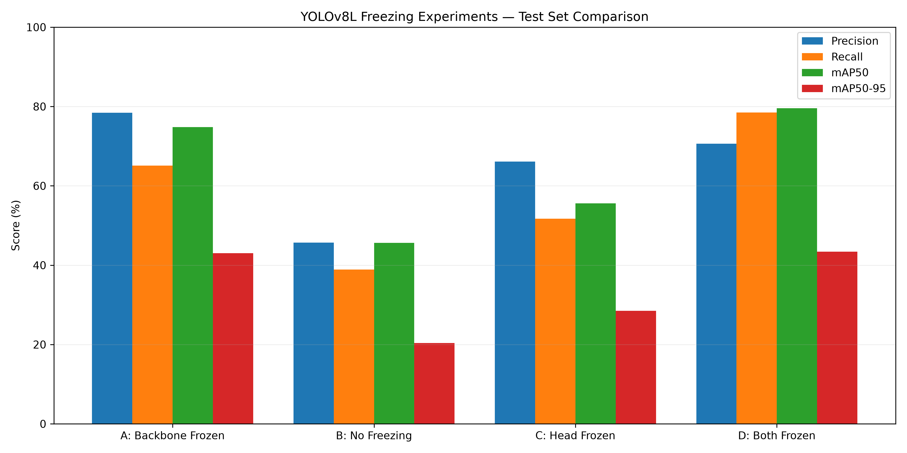
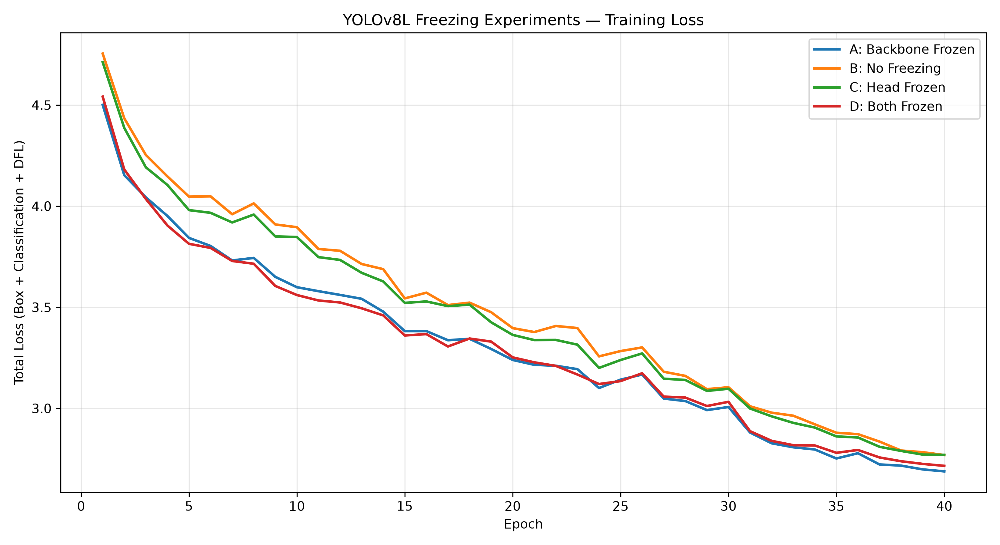
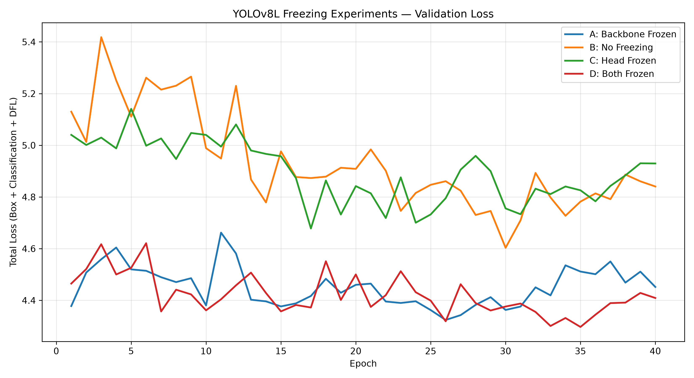

# Video Analyser — CCTV Object Detection & Analysis

A computer vision project developed during an internship at **Optara Systems**, focused on analysing CCTV footage, evaluating object detection models, and improving detection performance through fine-tuning.

## Project Overview

Video Analyser is a Python-based prototype designed to process CCTV footage and extract useful information from video frames.

The project combines traditional computer vision techniques, YOLO object detection models, and Google's Gemini API to identify objects, analyse scenes and generate structured results.

The project also includes separate benchmarking and fine-tuning workflows to investigate how different object detection models perform under various conditions.

### Main Objectives

- Automate the analysis of CCTV footage.
- Detect people and other relevant objects in images and videos.
- Compare object detection models for accuracy and processing speed.
- Improve detection performance through dataset preparation and fine-tuning.
- Investigate how freezing different neural network layers affects model performance.

---

## Features

### 1. CCTV Video Analysis Pipeline

The main pipeline processes video footage through several stages:

1. **Frame extraction** — Extract individual frames from a video.
2. **Frame selection** — Select representative frames for analysis.
3. **Object detection** — Identify people within selected frames.
4. **Scene analysis** — Use Google Gemini to interpret visual information.
5. **Structured output** — Generate JSON results containing analysis information.
6. **Visualisation** — Produce annotated frames showing detected objects.

The complete pipeline can be executed through a single Python command.

### 2. Image Benchmarking

The image benchmarking workflow evaluates object detection models against manually labelled ground-truth images.

Metrics include:

- Precision
- Recall
- F1 Score
- True Positives
- False Positives
- False Negatives

Results are exported as comparison tables and JSON summaries.

### 3. Video Benchmarking

The video benchmarking workflow evaluates YOLO models on CCTV footage with varying scene conditions.

Experiments include:

- Sparse, normal and crowded scenes.
- Different input resolutions, including 640 × 640 and 1280 × 1280.
- Comparisons between detection models.

Performance measurements include:

- Processing FPS
- Inference time
- Average people detected per frame

Outputs include annotated videos, JSON summaries and CSV comparison tables.

### 4. YOLOv8L Fine-Tuning

An additional experimental workflow investigates how fine-tuning affects YOLOv8 Large object detection performance.

The fine-tuning dataset contains **594 images** across four object classes:

| Class ID | Object |
|---|---|
| 0 | Person |
| 1 | Vehicle |
| 2 | Cat |
| 3 | Dog |

The dataset was reviewed to improve annotation quality, particularly where people or vehicles appeared in animal images without corresponding bounding boxes.

During the annotation audit:

- 44 animal images were reviewed.
- Missing person, vehicle and dog annotations were added.
- The number of bounding boxes in those images increased from 54 to 82.
- A separate cleaned dataset was created to preserve the original version.

The cleaned dataset was divided into:

| Split | Images |
|---|---:|
| Training | 519 |
| Validation | 37 |
| Testing | 38 |
| **Total** | **594** |

---

## YOLOv8L Freezing Experiments

Four controlled experiments were conducted to investigate how freezing different parts of a pretrained YOLOv8L model affects performance.

### Understanding Model Freezing

YOLOv8L contains three main components:

- **Backbone:** Extracts visual features from images.
- **Neck:** Combines features at different scales.
- **Detection head:** Produces bounding boxes and object-class predictions.

*Freezing* means keeping selected model parameters unchanged during training.

### Experiment Configurations

| Experiment | Frozen Components | Trainable Components |
|---|---|---|
| A — Backbone Frozen | Backbone | Neck + Head |
| B — No Freezing | None intentionally | Backbone + Neck + Head |
| C — Head Frozen | Detection Head | Backbone + Neck |
| D — Both Frozen | Backbone + Head | Neck |

All four experiments used the same dataset, training settings and random seed to support a controlled comparison.

### Training Configuration

| Parameter | Value |
|---|---|
| Model | YOLOv8 Large |
| Epochs | 40 |
| Image size | 640 |
| Batch size | 4 |
| Optimiser | AdamW |
| Initial learning rate | 0.0005 |
| Random seed | 42 |

### Experimental Results

Each model's best checkpoint was evaluated on the same held-out test dataset.

| Experiment | Precision | Recall | mAP50 | mAP50–95 |
|---|---:|---:|---:|---:|
| A — Backbone Frozen | **78.4%** | 65.1% | 74.8% | 43.0% |
| B — No Freezing | 45.7% | 38.9% | 45.6% | 20.4% |
| C — Head Frozen | 66.1% | 51.7% | 55.6% | 28.5% |
| D — Both Frozen | 70.6% | **78.5%** | **79.6%** | **43.4%** |

### Key Findings

- Experiment D achieved the highest recall and mAP scores.
- Experiment A achieved the highest precision.
- Both configurations with the backbone frozen outperformed the other configurations overall.
- Training losses decreased across all four experiments.
- Experiments A and D generally maintained lower validation losses.

These findings suggest that preserving pretrained backbone features may be beneficial when fine-tuning on a relatively small dataset.

However, the test set contained only 38 images, including very few cat and dog instances. Further evaluation would be needed before drawing broader conclusions.

### Performance Visualisations

**Test-set metric comparison**



**Training loss comparison**



**Validation loss comparison**



The graphs were generated using Python, pandas and Matplotlib.

---

## Project Structure

```text
video-analyser/
│
├── src/                         # Main CCTV video analysis pipeline
├── input/                       # Input videos
├── output/                      # Generated pipeline outputs
│
├── evaluation/                  # Image benchmarking scripts
├── evaluation_dataset/          # Labelled evaluation data
│
├── video_benchmark/             # Video benchmarking workflows
│
├── YOLOX/                       # YOLOX implementation
│
├── analysis/                    # Fine-tuning analysis and graphs
│   ├── freezing_experiments.py
│   ├── compare_freezing_results.py
│   ├── compare_freezing_losses.py
│   ├── freezing_experiments_comparison.png
│   ├── freezing_training_loss.png
│   └── freezing_validation_loss.png
│
├── animal_annotation_workspace/ # LabelMe annotation workspace
│
├── yolo_finetune_594/           # Original dataset configuration and labels
├── yolo_finetune_594_clean/     # Cleaned dataset configuration and labels
│
├── requirements.txt
└── README.md
```

**Note:** Some large datasets, generated outputs, training runs and model weights are excluded from version control.

---

## Requirements

- Python
- OpenCV
- PyTorch
- Ultralytics YOLO
- Google GenAI SDK
- python-dotenv
- LabelMe (for annotation work)

### Installation

Clone the repository:

```bash
git clone https://github.com/bariyanazha26/video-analyser.git
cd video-analyser
```

Install the project dependencies:

```bash
pip install -r requirements.txt
```

For Gemini-based scene analysis, configure the required API credentials in a local `.env` file according to the project's configuration.

---

## Running the Project

### CCTV Video Analysis

Place an input video inside:

```text
input/
```

Run:

```bash
python src/main.py
```

Expected outputs include selected frames, annotated frames and structured JSON analysis results.

### Image Benchmarking

Run YOLOv8 evaluation:

```bash
python evaluation/run_yolov8.py
```

Compare evaluated models:

```bash
python evaluation/evaluate_models.py
```

### Video Benchmarking

Run the video benchmarks:

```bash
python video_benchmark/run_video_benchmark.py
```

Generate model comparisons:

```bash
python video_benchmark/compare_video_models.py
```

### Generate Fine-Tuning Comparison Graphs

From the project root, run:

```bash
python analysis/compare_freezing_results.py
python analysis/compare_freezing_losses.py
```

These scripts use results from the completed training experiments. The original training logs and CSV files must be available at the expected local paths to regenerate the graphs.

The existing PNG visualisations are included in the repository.

---

## Technologies Used

- **Python** — Core development and experimentation
- **OpenCV** — Video and image processing
- **PyTorch** — Deep learning framework
- **Ultralytics YOLO** — Object detection and fine-tuning
- **YOLOX** — Alternative object detection implementation
- **Google Gemini API** — Scene interpretation
- **LabelMe** — Manual bounding-box annotation
- **pandas and Matplotlib** — Performance analysis and visualisation
- **Git and GitHub** — Version control

---

## Limitations

- Fine-tuning was conducted using a relatively small dataset.
- Animal classes were underrepresented in the test set.
- Results were obtained using a single random seed.
- Model performance may differ on other CCTV environments and camera conditions.
- Large image datasets and trained model checkpoints are not included in the repository.

## Future Improvements

Potential areas for further development include:

- Expanding the dataset with more representative CCTV imagery.
- Further evaluating precision and recall trade-offs.
- Investigating controlled weight-update restrictions.
- Comparing newer YOLO models and alternative detection architectures.
- Supporting real-time CCTV and webcam processing.
- Developing an interactive visual dashboard.
- Exploring cloud deployment.

---

## Project Context

This project was developed as part of a software engineering internship at **Optara Systems**.

The work involved practical experience in computer vision, machine learning experimentation, dataset annotation, model benchmarking and performance analysis.

The repository documents the prototype's development and the experimental work completed during the internship.
